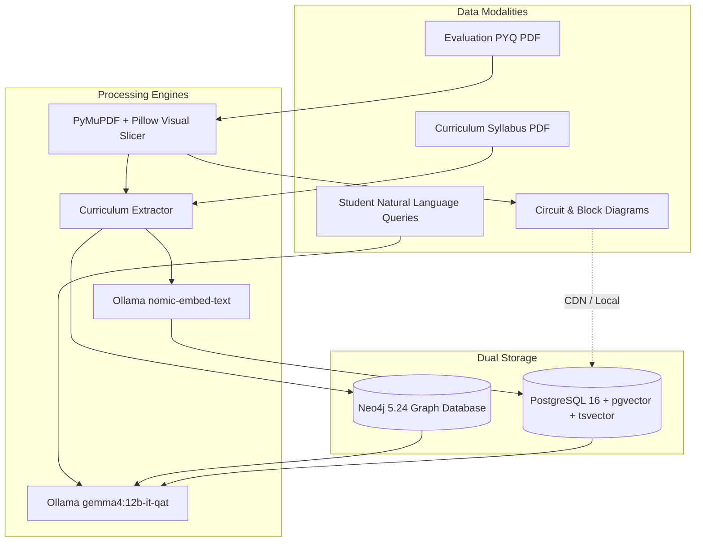
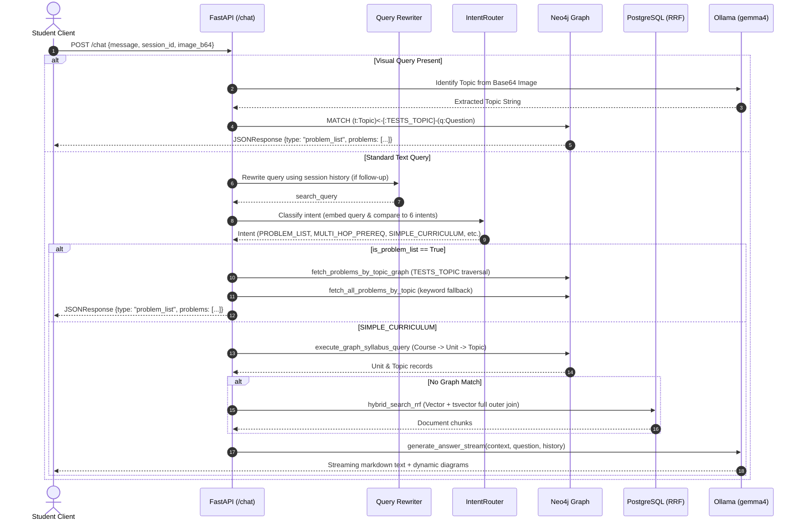
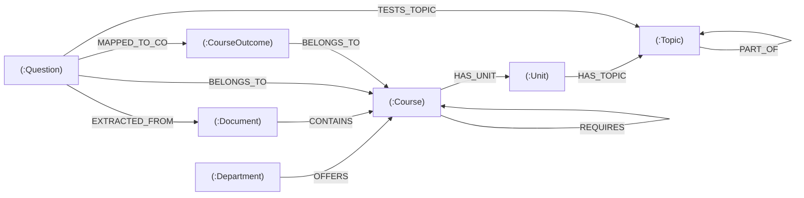
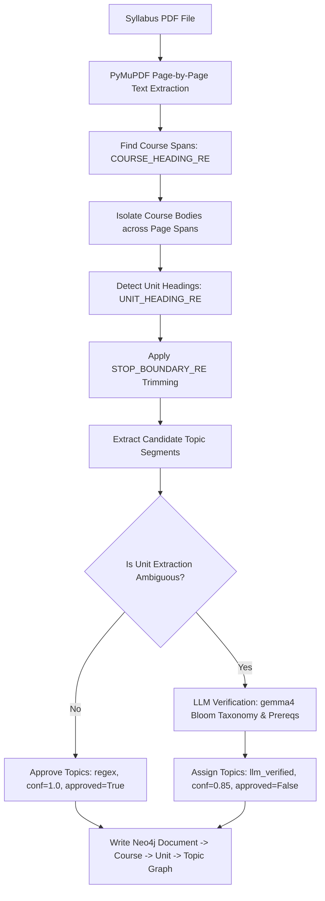
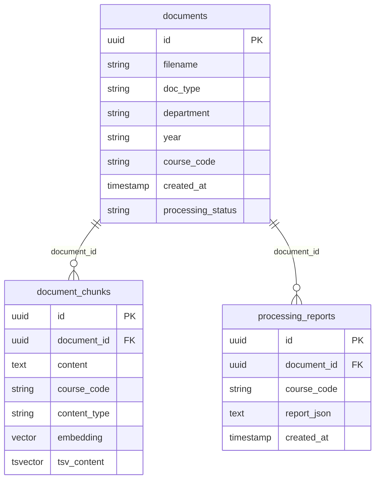
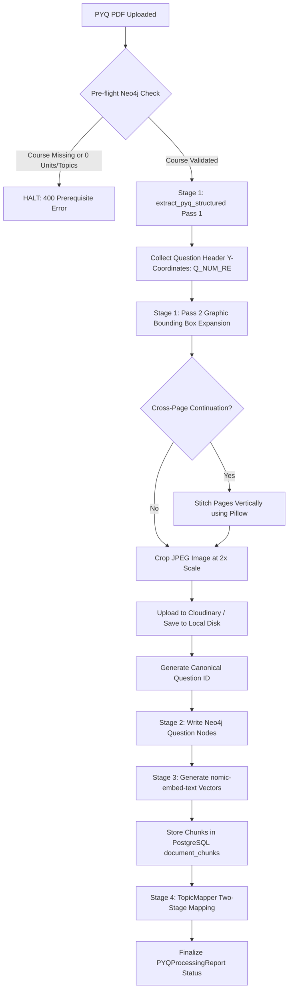
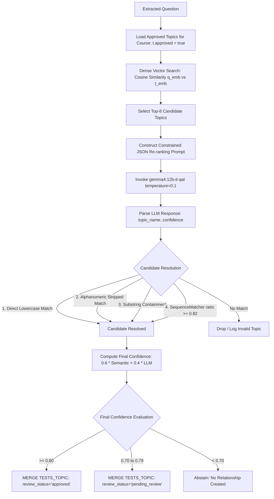
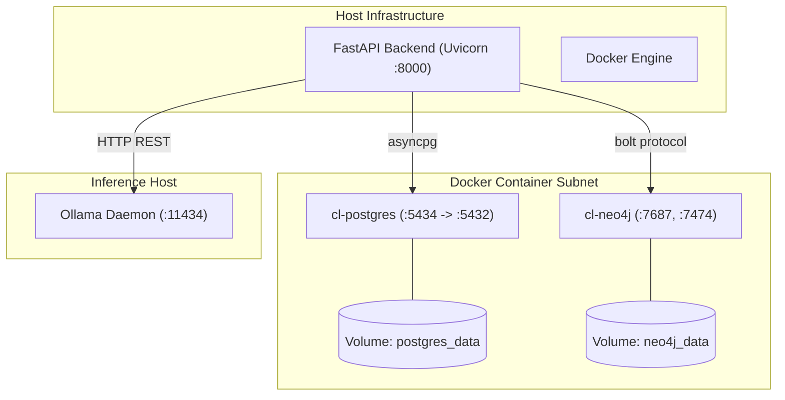

# IMPLEMENTATION.md — Multimodal Academic Cognitive Hub (M.A.C.H.)
## Comprehensive Technical Implementation Reference, Architecture Specification, and Research Baseline

---

## 1. Title and Document Information

- **Project Name:** M.A.C.H. — Multimodal Academic Curriculum Hub / Multimodel Academic Cognitive Hub
- **Also Referred to In-Codebase As:** Campus Knowledge Engine, CurriculumLens
- **Institutional Context:** Amrita Vishwa Vidyapeetham, Coimbatore (Department of Computer Science and Engineering)
- **Project Category:** Hybrid Information Retrieval (IR), Multimodal Retrieval-Augmented Generation (RAG), Graph Databases (GraphRAG), Knowledge Engineering, and Academic Analytics
- **Document Purpose:** 
  1. Authoritative software engineering and architectural specification of the active repository.
  2. Technical and mathematical foundation for research paper publication.
  3. Reproducibility reference for independent academic evaluation.
  4. Maintenance and auditing reference for engineers and examiners.
- **Repository Scope Inspected:** Complete repository tree including `backend/` (`app.py`, `curriculum_extractor.py`, `database.py`, `embedder.py`, `intent_router.py`, `pyq_processor.py`, `query_neo4j.py`, `topic_mapper.py`, `utils.py`, `vision_query.py`), `backend/migrations/` (`neo4j_schema.py`, `legacy_migration.py`), `backend/tests/` (`test_curriculum_extractor.py`, `test_pyq_processor.py`, `test_topic_mapper.py`), `frontend/` (`index.html`, `admin.html`, `student.html`, `src/js/core/`, `src/js/pages/`, `src/css/`), deployment manifests (`Dockerfile`, `docker-compose.yml`, `requirements.txt`), design blueprints (`docs/architecture_plan.md`, `docs/database_schema.md`), and historical documentation.
- **Documentation Generation Date:** October 14, 2026
- **Git Commit Baseline:** `5e3f549` (`as_of_sep4_final`), Branch: `integration` (incorporating active unstaged working-tree refinements across backend modules)
- **Current Implementation Status:** Fully operational backend service and web application for Syllabus Knowledge Graph Ingestion, Dual-pass Visual PYQ Slicing, Dense Semantic Search, Tsvector Full-Text Search, Reciprocal Rank Fusion (RRF), Two-Stage Topic Mapping, and Graph RAG Chat.
- **Known Limitations of Documentation:** Physical database containers (PostgreSQL and Neo4j) and local Ollama daemon were inactive on the local host at inspection time; live inference latency figures represent engineering approximations and benchmark fixtures, whereas static code analysis, AST tracing, SQL/Cypher parsing, and unit test executions reflect direct empirical verification.

---

## 2. Project Overview

### 2.1 Problem Statement
Higher education academic ecosystems produce high-entropy, polyglot document corpora:
- Syllabi represent deeply structured hierarchical curricula (Department $\rightarrow$ Course $\rightarrow$ Unit $\rightarrow$ Topic) with implicit cognitive taxonomies (Bloom's Taxonomy Levels L1–L6) and inter-course prerequisite chains.
- Previous Year Question (PYQ) papers contain multi-part evaluation instruments with domain-specific schematics (circuit diagrams, block diagrams, mathematical formulas) tagged to Course Outcomes (COs) and Bloom's Taxonomy Levels (BTLs).
- Institutional policies and regulations consist of unstructured legalistic prose requiring high-precision citation and strict abstention against hallucinated rules.

Standard flat vector-only RAG systems suffer from critical semantic failure modes in this environment:
1. *Contextual Fragmentation:* Slicing hierarchical syllabi into uniform 512-token chunks breaks parent-child course hierarchies.
2. *Visual Blindness:* Standard OCR fails on electronic schematics, circuit diagrams, and mathematical symbols.
3. *Cross-Course Contamination:* Semantic vector search across courses often matches identical concept names (e.g., "Transforms" in Signals & Systems vs. Linear Algebra vs. Computer Graphics).
4. *Query-Type Mismatch:* Fact-lookup queries (e.g., prerequisite sequences or question lists) require deterministic graph traversal, not probabilistic text generation.

### 2.2 System Capabilities
M.A.C.H. resolves these challenges through a dual-persistence, graph-grounded cognitive architecture:
- **Deterministic Syllabus Extraction:** Page-boundary-preserving parser that extracts Course, Unit, and Topic entities, detecting stop boundaries (e.g., textbook bibliographies) and constructing typed relationships in Neo4j.
- **Two-Pass Visual PYQ Processing:** High-resolution page rendering (PyMuPDF at $2\times$ scale) with dynamic physical Y-coordinate bounding-box detection, automatic diagram/circuit enclosure expansion, cross-page question continuation stitching, and Cloudinary/local image persistence.
- **GraphRAG and Course-Scoped Retrieval:** Strict relational grounding where candidate queries are scoped by canonical course codes, eliminating cross-course contamination.
- **Two-Stage Topic Mapping:** Hybrid candidate retrieval combining dense vector similarity with zero-shot LLM re-ranking, strictly bound to valid curriculum topic nodes.
- **Unified Academic Router:** Multi-turn intent router dispatching queries between graph traversal paths, PostgreSQL hybrid RRF search, and selective generative streaming.

### 2.3 System Entities and Data Modalities



---

## 3. System Architecture

### 3.1 Architectural Topology
M.A.C.H. employs an asynchronous, polyglot storage architecture built on Python 3.11/3.12, FastAPI, SQLAlchemy (AsyncPG), Neo4j Bolt Driver, and Ollama.

```mermaid
graph TB
    subgraph Client Layer
        WebClient[Web Browser - Vanilla JS PWA]
        AdminUI[Admin Dashboard /admin.html]
        StudentUI[Student Chat Interface /student.html]
    end

    subgraph API Gateway - FastAPI
        AuthMW[JWT Auth & CORS Middleware]
        RouteChat[POST /chat & POST /image-query]
        RouteUpload[POST /upload & POST /documents]
        RouteAdmin[GET/PUT /admin/* Review & Diagnostics]
        RouteGraph[GET /graph/{course_code}]
    end

    subgraph Core Logic & Orchestration
        Router[IntentRouter - Cosine Embedding Classifier]
        Rewriter[Query Rewriter - Multi-turn History]
        VisualProc[PyMuPDF / Pillow Crop Engine]
        CurricProc[Curriculum Extractor & Regex Engine]
        TopicMap[TopicMapper - Two-Stage Dense + LLM]
    end

    subgraph Retrieval & Persistence
        PG_Store[(PostgreSQL 16)]
        PG_Vec[pgvector HNSW Cosine Index]
        PG_FTS[tsvector Stored Column + GIN Index]
        N4J_Store[(Neo4j 5.24 Community)]
        N4J_Schema[Unique Constraints & Indexes]
    end

    subgraph External Inference & Media Services
        OllamaLLM[Ollama: gemma4:12b-it-qat]
        OllamaEmb[Ollama: nomic-embed-text]
        CloudinaryCDN[Cloudinary Image CDN / Local Disk Fallback]
    end

    WebClient --> AuthMW
    AuthMW --> RouteChat
    AuthMW --> RouteUpload
    AuthMW --> RouteAdmin
    AuthMW --> RouteGraph

    RouteChat --> Rewriter --> Router
    Router -->|PROBLEM_LIST| N4J_Store
    Router -->|MULTI_HOP_PREREQ| N4J_Store
    Router -->|SIMPLE_CURRICULUM| N4J_Store
    Router -->|Fallback RRF| PG_Store
    
    RouteUpload --> VisualProc
    RouteUpload --> CurricProc
    VisualProc --> CloudinaryCDN
    CurricProc --> N4J_Store
    VisualProc --> TopicMap --> N4J_Store
    VisualProc --> OllamaEmb --> PG_Store

    PG_Store --- PG_Vec
    PG_Store --- PG_FTS
    N4J_Store --- N4J_Schema

    Router -.-> OllamaLLM
    TopicMap -.-> OllamaLLM
    TopicMap -.-> OllamaEmb
```

### 3.2 Request Lifecycle: End-to-End Execution Trace



---

## 4. Technology Stack

| Layer | Component / Tool | Verified Version / Implementation | Runtime Location | Selection Rationale & Role |
|---|---|---|---|---|
| **Language Runtime** | Python | 3.11 (Dockerfile) / 3.12 (Host) | Global | Base environment for backend services and ML libraries. |
| **API Framework** | FastAPI | `fastapi` | `backend/app.py:9` | High-throughput ASGI async web framework with automated OpenAPI validation. |
| **ASGI Server** | Uvicorn | `uvicorn[standard]` | `backend/app.py:1845` | High-performance asynchronous HTTP server with uvloop event loop. |
| **Relational Database** | PostgreSQL | 16.0 (`pgvector/pgvector:pg16`) | Docker Container (`cl-postgres:5434`) | Master store for document registry, processing reports, and chunk text. |
| **Vector Engine** | pgvector | 0.7+ (`Vector(768)`) | `backend/database.py:17, 114` | In-database cosine vector indexing (`vector_cosine_ops`) via HNSW. |
| **Lexical Engine** | PostgreSQL tsvector | Stored Generated Column + GIN | `backend/app.py:73-79` | Exact lexical full-text search with English stemming and term frequency ranking. |
| **Graph Database** | Neo4j Community | 5.24 (`neo4j:5.24-community`) | Docker Container (`cl-neo4j:7687, 7474`) | Index-free adjacency store for curriculum trees, prerequisites, and evaluation mappings. |
| **Database ORM** | SQLAlchemy | `sqlalchemy[asyncio]`, `asyncpg` | `backend/database.py:10-12` | Asynchronous connection pooling and schema object modeling. |
| **PDF Extraction** | PyMuPDF (fitz) | `pymupdf` (v1.24+) | `backend/utils.py:19`, `backend/curriculum_extractor.py:36` | Direct low-level access to PDF text blocks, bounding boxes, vector drawings, and raster rendering. |
| **Image Processing** | Pillow (PIL) | `pillow` | `backend/utils.py:219` | Coordinate-based pixel cropping, scale transformation, and vertical image stitching. |
| **Cloud Media Storage**| Cloudinary | `cloudinary` SDK | `backend/utils.py:39-93` | External CDN hosting for cropped schematic question figures with local disk fallback. |
| **Language Model (LLM)**| Google Gemma 4 | `gemma4:12b-it-qat` (Ollama) | Local / Colab Tunnel | 12B parameter multimodal vision model for synthesis, query rewriting, and diagram reading. |
| **Embedding Model** | Nomic Embed | `nomic-embed-text` (Ollama) | Local / Colab Tunnel | 137M parameter 768-dimensional dense representation model for text and topics. |
| **HTTP Client** | HTTPX | `httpx` (async) | `backend/embedder.py:56`, `backend/utils.py:191` | Fully asynchronous HTTP request client for Ollama API communication with ngrok headers. |
| **Authentication** | Python-Jose | `python-jose[cryptography]` | `backend/app.py:12, 146-177` | Stateless JSON Web Token (JWT) issuance, HS256 signing, and RBAC verification. |
| **Frontend Core** | Vanilla HTML5 / ES6 | Native Browser ES Modules | `frontend/src/js/` | Zero-build, native browser execution avoiding heavy node_modules build overhead. |
| **Styling** | Vanilla CSS3 | Custom CSS Custom Properties | `frontend/src/css/` | Pure CSS design system featuring dark mode, glassmorphism, and responsive layouts. |
| **Testing** | Pytest | `pytest-7.4.0`, `pytest-asyncio` | `backend/tests/` | Automated test runner for extraction, persistence safety, and topic mapping. |

---

## 5. Repository Structure

```
Campus-Knowledge-Engine/
├── .env.example                     # Environment template specifying model IDs and ports
├── .gitignore                       # Git ignore rules for virtual environments, caches, and uploads
├── Dockerfile                       # Python 3.11-slim container specification
├── docker-compose.yml               # Multi-container orchestration (PostgreSQL 16 + Neo4j 5.24)
├── requirements.txt                 # Pinned and compatible Python dependencies
├── backend/
│   ├── app.py                       # Main FastAPI application, routing, lifespan, and chat logic
│   ├── curriculum_extractor.py      # Deterministic & LLM-verified syllabus parser and Neo4j builder
│   ├── database.py                  # PostgreSQL (SQLAlchemy AsyncPG) and Neo4j connection drivers
│   ├── embedder.py                  # nomic-embed-text wrapper, in-memory LRU cache, cosine similarity
│   ├── intent_router.py             # 6-intent embedding-based query classifier
│   ├── pyq_processor.py             # PYQ persistence, prerequisite safety validation, ProcessingReport
│   ├── query_neo4j.py               # Optimized Cypher queries for Graph RAG and course visualization
│   ├── topic_mapper.py              # Two-stage dense retrieval + LLM re-ranking question-topic mapper
│   ├── utils.py                     # Two-pass PDF slicer, Cloudinary upload, RRF SQL, query rewriter
│   ├── vision_query.py              # Multimodal reverse lookup for student-uploaded diagram images
│   ├── migrations/
│   │   ├── __init__.py
│   │   ├── neo4j_schema.py          # Cypher DDL for uniqueness constraints and composite indexes
│   │   └── legacy_migration.py      # Idempotent backfill script migrating legacy QuestionModel edges
│   ├── tests/
│   │   ├── __init__.py
│   │   ├── test_curriculum_extractor.py # Regex, boundary, and topic validation tests
│   │   ├── test_pyq_processor.py    # Persistence contract, safety checks, and report unit tests
│   │   └── test_topic_mapper.py     # Cosine math, keyword overlap, and selection logic tests
│   └── uploads/                     # Local storage for uploaded PDF files and cropped JPEG images
├── frontend/
│   ├── index.html                   # Interactive sign-in portal with HTML5 Canvas Knowledge Graph
│   ├── admin.html                   # Document management, review workflows, and diagnostics dashboard
│   ├── student.html                 # Student academic copilot with streaming chat and graph renderer
│   ├── service-worker.js            # PWA background service worker
│   ├── manifest.json                # PWA manifest
│   └── src/
│       ├── css/
│       │   ├── base.css             # Reset and base typography
│       │   ├── components.css       # Buttons, cards, modals, tables, and form controls
│       │   ├── layout.css           # Grid systems and view wrappers
│       │   ├── main.css             # Aggregated stylesheet
│       │   └── variables.css        # HSL color palettes, typography tokens, and spacing variables
│       └── js/
│           ├── core/
│           │   ├── api.js           # Fetch wrapper injecting JWT bearer tokens and handling 401s
│           │   ├── auth.js          # LocalStorage token accessors and route guards
│           │   └── utils.js         # HTML escaping, timestamping, and Markdown parsing
│           └── pages/
│               ├── admin.js         # Document uploads, topic approval, merge, and diagnostics
│               ├── login.js         # JWT auth dispatcher and animated Canvas graph simulation
│               └── student.js       # SSE chat stream reader, voice input, and graph visualizer
└── docs/
    ├── api_docs.md                  # Endpoint documentation
    ├── architecture.md              # High-level architecture guide
    ├── architecture_plan.md         # Comprehensive architectural blueprint and design targets
    ├── database_schema.md           # Entity-relationship and Cypher schema specification
    └── troubleshooting.md          # Diagnostic and debugging guide
```

---

## 6. Backend Architecture

### 6.1 Application Initialization and Lifespan
The backend application is initialized in `backend/app.py:100` via FastAPI with an asynchronous lifespan context manager (`backend/app.py:58-98`):
1. **PostgreSQL Extension Activation:** Executes `CREATE EXTENSION IF NOT EXISTS vector` to ensure vector operations are native.
2. **Table Schema Synchronization:** Runs `await conn.run_sync(Base.metadata.create_all)` to create `documents`, `document_chunks`, and `processing_reports`.
3. **Generated Column & GIN Creation:** Alters `document_chunks` to add `tsv_content TSVECTOR GENERATED ALWAYS AS (to_tsvector('english', content)) STORED` and creates the `idx_chunks_tsv` GIN index (`backend/app.py:72-79`).
4. **Prerequisite Graph Seeding:** Connects to Neo4j and invokes `add_prerequisite_edges(neo4j_driver, PREREQUISITE_MAP)` (`backend/app.py:91-94`) to seed academic prerequisites.

### 6.2 Connection Management & Concurrency Control
- **PostgreSQL Connection Pool:** Configured in `backend/database.py:49-52` via SQLAlchemy's `create_async_engine` using `asyncpg`. Sessions are injected into endpoint handlers using the async generator dependency `get_db()` (`backend/database.py:152-159`).
- **Neo4j Driver Lifecycle:** A shared singleton `neo4j.GraphDatabase.driver` is created in `backend/database.py:171`. Sessions are opened synchronously or within async wrappers using `with neo4j_driver.session() as session:`.
- **Async Concurrency Throttling:**
  - Embedding requests are bound by an `asyncio.Semaphore(1)` in `backend/embedder.py:37` to prevent saturating Ollama server queues.
  - Background PYQ extraction and ingestion runs under an `asyncio.Semaphore(1)` in `backend/app.py:362` to prevent GPU memory exhaustion during multimodal vision analysis.

---

## 7. API Documentation

### 7.1 Public Endpoints

#### POST `/login`
- **File & Line:** `backend/app.py:161-177`
- **Purpose:** Authenticates user credentials and issues a signed JWT token.
- **Request Form Parameters:** `username` (str), `password` (str).
- **Verified Demo Credentials:** `student` / `student123` (role: `student`), `admin` / `admin123` (role: `admin`).
- **Response Schema:**
  ```json
  {
    "access_token": "eyJhbGciOiJIUzI1NiIsInR5cCI6IkpXVCJ9...",
    "token_type": "bearer"
  }
  ```

#### POST `/chat`
- **File & Line:** `backend/app.py:460-739`
- **Purpose:** Primary interaction interface for natural language student queries.
- **Request Body Schema (`ChatRequest`):**
  ```json
  {
    "message": "What is Superposition Theorem and show previous questions?",
    "session_id": "c56a4180-2a2b-47e2-8924-d9bc992d9d15",
    "image_b64": null
  }
  ```
- **Responses:**
  - *Direct JSON Problem List (`X-Response-Type: problem_list`):* Returned when intent is `PROBLEM_LIST` or when questions exist in Neo4j (`backend/app.py:568-576`):
    ```json
    {
      "type": "problem_list",
      "topic": "Superposition Theorem",
      "problems": [
        {
          "id": "a1b2c3d4...",
          "question_number": "1a",
          "text": "Calculate the current I through the 5 ohm resistor...",
          "marks": 10,
          "btl": "BTL3",
          "image_url": "https://res.cloudinary.com/.../crop.jpg",
          "course_code": "23CSE104",
          "co_id": "CO1",
          "topic_name": "Superposition Theorem",
          "mapping_confidence": 0.94
        }
      ],
      "source": "graph"
    }
    ```
  - *Streaming Markdown (`text/plain`):* Chunked stream synthesized by `gemma4:12b-it-qat` with appended diagram markdown (`backend/app.py:703-739`).

#### POST `/image-query`
- **File & Line:** `backend/app.py:1075-1173`
- **Purpose:** Reverse lookup: identifies circuit/formula from uploaded image and finds corresponding syllabus location.
- **Payload:** Multipart form file `file`.

#### GET `/graph/{course_code}`
- **File & Line:** `backend/app.py:1826-1837`
- **Purpose:** Returns bidirectional nodes and edges for visualization in the interactive graph canvas.

### 7.2 Administrative Endpoints (Bearer Token Required)

| Method | Endpoint | Source File:Lines | Description |
|---|---|---|---|
| `POST` | `/upload` | `backend/app.py:809-902` | Uploads single/multiple PDFs, checks curriculum pre-flight, and enqueues background processing. |
| `GET` | `/documents` | `backend/app.py:908-933` | Lists all documents with current `processing_status`. |
| `DELETE`| `/documents/{doc_id}` | `backend/app.py:939-1018` | Cascading delete across PostgreSQL, Neo4j nodes, local disk, and Cloudinary. |
| `POST` | `/reset` | `backend/app.py:1024-1069`| Complete purge of all databases, uploads directory, and Cloudinary media assets. |
| `GET` | `/admin/extraction-review/courses` | `backend/app.py:1546-1562` | Aggregates course units, approved topics, and pending LLM-derived topics. |
| `GET` | `/admin/extraction-review/courses/{code}` | `backend/app.py:1564-1583` | Retrieves unit text and candidate topic list for verification. |
| `PUT` | `/admin/extraction-review/topics/{topic_id}` | `backend/app.py:1589-1609` | Edits topic name, normalized name, or manually toggles `approved` flag. |
| `POST` | `/admin/extraction-review/topics/merge` | `backend/app.py:1615-1637` | Merges duplicate topics, migrating `HAS_TOPIC` and `TESTS_TOPIC` edges. |
| `POST` | `/admin/extraction-review/courses/{code}/approve` | `backend/app.py:1639-1654`| Bulk-approves all topics extracted for a given course. |
| `GET` | `/admin/pyq-processing/{document_id}` | `backend/app.py:1660-1691` | Retrieves detailed `PYQProcessingReport` with timings and skip reasons. |
| `GET` | `/admin/diagnostics/pyq/{course_code}` | `backend/app.py:1693-1723` | Aggregate question counts, CO coverage, and per-document counts. |
| `GET` | `/admin/diagnostics/pyq/{course_code}/questions` | `backend/app.py:1725-1765` | Returns table of all extracted questions with assigned topics and confidence. |
| `GET` | `/admin/topic-mapping-review/{course_code}` | `backend/app.py:1771-1797` | Inspects `TESTS_TOPIC` relationships categorized by `review_status`. |
| `PUT` | `/admin/topic-mapping-review/{rel_id}` | `backend/app.py:1803-1820` | Modifies relationship review status (`approved` or `rejected`). |
| `GET` | `/evaluate` | `backend/app.py:200-220` | Fetches pipeline RAGAS evaluation metrics for admin dashboard visualizer. |

---

## 8. Intent Routing and Query Understanding

### 8.1 Intent Taxonomy
The routing layer in `backend/intent_router.py:4-11` establishes six distinct academic intent categories:

```python
INTENT_DESCRIPTIONS = {
    "PROBLEM_LIST": "Ask for a list of problems or past year questions on a specific topic or concept.",
    "MULTI_HOP_PREREQ": "Ask about prerequisites, what should I know before taking, or what is needed for a topic.",
    "GRAPH_PYQ_MAPPING": "Ask about Bloom's taxonomy level (BTL), course outcomes (CO), or how questions map to outcomes.",
    "SIMPLE_CURRICULUM": "Ask about syllabus, topics, units, objectives, or curriculum structure.",
    "SIMPLE_PYQ": "Ask for a specific past year question, exam paper, midterm, endsem, or circuit problem.",
    "GENERAL": "General conversation, greetings, or questions outside the curriculum or previous year questions scope."
}
```

### 8.2 Classification Mechanism
Intent classification is embedding-based:
1. **Pre-computation:** On application startup, `IntentRouter.initialize()` generates and caches 768-dimensional embeddings for all six intent descriptions via `nomic-embed-text` (`backend/intent_router.py:18-27`).
2. **Inference:** When a query enters `classify_intent(question)`:
   - The query is embedded: $\mathbf{q} \in \mathbb{R}^{768}$.
   - Cosine similarity is computed against each intent embedding $\mathbf{t}_i$:
     $$S_i = \cos(\mathbf{q}, \mathbf{t}_i) = \frac{\mathbf{q} \cdot \mathbf{t}_i}{\|\mathbf{q}\|_2 \|\mathbf{t}_i\|_2}$$
   - The best scoring intent is selected: $i^* = \arg\max_i S_i$.
   - **Abstention / Fallback:** If $\max_i S_i < 0.4$, the classification defaults to `"GENERAL"` (`backend/intent_router.py:46-47`).
3. **Rule Override:** For high-volume query types like problem listing, `backend/app.py:522-534` provides explicit substring matching (e.g., `"problems on"`, `"pyqs on"`, `"previous year question"`) that forces `is_problem_list = True` regardless of semantic similarity fluctuations.

---

## 9. Neo4j Knowledge Graph

### 9.1 Graph Schema and Node Specifications



#### Node Labels and Properties

| Node Label | Key Properties | Data Types | Source File & Function | Constraints & Indexes |
|---|---|---|---|---|
| `Department` | `name` | String | `curriculum_extractor.py:540` | Lookup key. |
| `Document` | `id`, `doc_type`, `department`, `year`, `course_code`, `created_at` | UUID (str), String, Timestamp | `curriculum_extractor.py:562`, `pyq_processor.py:215` | Unique Constraint: `d.id IS UNIQUE` |
| `Course` | `code`, `name`, `department`, `year`, `document_id` | String | `curriculum_extractor.py:550` | Unique Constraint: `c.code IS UNIQUE` |
| `Unit` | `id`, `number`, `title`, `raw_text`, `course_code`, `document_id` | String, Text | `curriculum_extractor.py:582` | ID Hash: `md5(doc_id + c_code + unit_num)` |
| `Topic` | `id`, `name`, `normalized_name`, `raw_text`, `bloom_level`, `extraction_method`, `extraction_confidence`, `approved`, `embedding` | String, Float, Boolean, JSON String | `curriculum_extractor.py:607`, `topic_mapper.py:114` | Unique Constraint: `t.id IS UNIQUE`<br>Indexes: `normalized_name`, `course_code`, `approved` |
| `Question` | `id`, `text`, `question_number`, `marks`, `btl`, `has_figure`, `image_url`, `document_id`, `course_code`, `extraction_method`, `extraction_status` | String, Integer, Boolean, Timestamp | `pyq_processor.py:274` | Unique Constraint: `q.id IS UNIQUE`<br>Index: `course_code` |
| `CourseOutcome`| `id`, `course_code` | String | `pyq_processor.py:309` | Composite identifier (e.g., `CO1` scoped to Course). |

#### Relationship Types and Semantics

| Source Node | Relationship | Target Node | Cardinality | Properties | Purpose |
|---|---|---|---|---|---|
| `Department` | `OFFERS` | `Course` | $1:N$ | — | Institutional organizational hierarchy. |
| `Document` | `CONTAINS` | `Course` | $1:N$ | — | Originating source document linkage. |
| `Course` | `HAS_UNIT` | `Unit` | $1:N$ | — | Structural curriculum module decomposition. |
| `Unit` | `HAS_TOPIC` | `Topic` | $1:N$ | — | Unit-to-concept relationship. |
| `Topic` | `PREREQUISITE_OF` | `Topic` | $N:M$ | — | Intra-course concept dependency. |
| `Topic` | `PART_OF` | `Topic` | $N:M$ | — | Concept composition hierarchy. |
| `Course` | `REQUIRES` | `Course` | $N:M$ | — | Inter-course curriculum prerequisite chain. |
| `Question` | `BELONGS_TO` | `Course` | $N:1$ | `migrated_from_legacy` | Direct authoritative course ownership. |
| `Question` | `EXTRACTED_FROM`| `Document` | $N:1$ | — | Provenance link to source PYQ PDF. |
| `Question` | `TESTS_TOPIC` | `Topic` | $N:M$ | `confidence`, `semantic_score`, `keyword_score`, `mapping_method`, `review_status`, `mapped_at` | GraphRAG evaluation-to-syllabus bridge. |
| `Question` | `MAPPED_TO_CO` | `CourseOutcome`| $N:1$ | — | Evaluation mapping to institutional CO targets. |
| `CourseOutcome`| `BELONGS_TO` | `Course` | $N:1$ | — | Scopes Course Outcomes to academic course. |

---

## 10. Syllabus Ingestion and Structuring

### 10.1 Processing Pipeline
Syllabus extraction (`backend/curriculum_extractor.py`) executes an 8-stage boundary-preserving extraction:



### 10.2 Regex Boundary Definitions and Topic Filtering Rules
- **Course Heading Regex (`backend/curriculum_extractor.py:48-51`):**
  ```python
  COURSE_HEADING_RE = re.compile(
      r'^([0-9]{2}[A-Za-z]{2,4}[0-9]{2,3})\s+(.+?)\s+L[\s\-]T[\s\-]P[\s\-]C',
      re.IGNORECASE | re.MULTILINE
  )
  ```
- **Unit Boundary Regex (`backend/curriculum_extractor.py:54-57`):**
  ```python
  UNIT_HEADING_RE = re.compile(r'(?:Syllabus\s*)?Unit\s*([IVX]+|\d+)', re.IGNORECASE)
  ```
- **Stop Boundary Regex (`backend/curriculum_extractor.py:78-81`):**
  ```python
  STOP_BOUNDARY_RE = re.compile(
      r'^(?:TEXTBOOK|TEXT\s*BOOK|REFERENCE|ESSENTIAL\s+READING|Evaluation\s+Pattern|Assessment|TEXTBOOKS|REFERENCES)\b',
      re.IGNORECASE | re.MULTILINE
  )
  ```
- **Topic Validation Rules (`backend/curriculum_extractor.py:192-226`):**
  Rejects candidates matching:
  - String length $< 4$ or $> 90$ characters.
  - Academic generic stop words: `{"introduction", "overview", "summary", "conclusion", "and", "the", "of", "in"}`.
  - Numeric strings or standalone publication years: `re.fullmatch(r'(19|20)\d{2}', t)`.
  - Author name formats: `re.compile(r'^[A-Z][a-z]+,\s*$')` (e.g., `"Hopcroft,"`).
  - Publisher/ISBN tokens: `Edition`, `ISBN`, `Press`, `McGraw`, `Pearson`, `Wiley`.
  - Sentence fragments: Single lower-case words `re.fullmatch(r'[a-z]+', t)`.

---

## 11. Document Storage and Metadata

### 11.1 Document Persistence Architecture
Documents are tracked across two tiers:
1. **Binary and Image Tier:**
   - Raw PDF files are stored on disk in `backend/uploads/{uuid}_{original_filename}` (`backend/app.py:869`).
   - Cropped question schematics are either pushed to Cloudinary CDN under asset folder `campus_ke/{document_id}_...` or stored locally at `backend/uploads/images/{public_id}.jpg` and mounted as `/static/images/...` (`backend/utils.py:74-101`).
2. **Metadata Tier (`documents` table in PostgreSQL):**
   - Tracks document lifecycle status: `pending` $\rightarrow$ `processing` $\rightarrow$ `completed` / `partially_completed` / `failed` (`backend/database.py:84-89`).
   - Foreign key parent for all vector text chunks in `document_chunks`.

---

## 12. Embedding Pipeline

### 12.1 Model Parameters and Embedder Operations
- **Model Identifier:** `nomic-embed-text` via Ollama API (`OLLAMA_EMBED_BASE_URL/api/embeddings`) (`backend/embedder.py:14, 58`).
- **Embedding Dimensions:** 768 floating point numbers.
- **Normalization:** L2-normalized representation returned by Nomic model.
- **In-Memory Caching:** Thread-safe `LRUCache(capacity=2000)` (`backend/embedder.py:35`) caches embeddings by raw text string to prevent redundant API roundtrips.
- **Rate-Limiting & Backoff:** Asynchronous semaphore (`asyncio.Semaphore(1)`) serializes embedding queries. Catches HTTP 403 (e.g., ngrok rate limits) and applies linear backoff: $15 \times (\text{attempt} + 1)$ seconds (`backend/embedder.py:68-71`).
- **Graph Embedding Caching:** Approved topic embeddings are serialized as JSON strings directly onto Neo4j Topic nodes (`t.embedding`) during topic mapping, preventing re-embedding overhead on recurring lookups (`backend/topic_mapper.py:108-115`).

---

## 13. Semantic Retrieval

### 13.1 Vector Similarity Search
Semantic vector search in PostgreSQL operates on the `document_chunks` table:
- **pgvector Cosine Operator:** `<=>` computes the cosine distance:
  $$D_{\cos}(\mathbf{u}, \mathbf{v}) = 1 - \frac{\mathbf{u} \cdot \mathbf{v}}{\|\mathbf{u}\|_2 \|\mathbf{v}\|_2}$$
- **Index Specification:** Hierarchical Navigable Small World (HNSW) index defined in `backend/database.py:118-126`:
  ```sql
  CREATE INDEX ix_document_chunks_embedding_hnsw 
  ON document_chunks 
  USING hnsw (embedding vector_cosine_ops) 
  WITH (m = 16, ef_construction = 64);
  ```
- **Course Scoping:** Cosine queries are constrained by `WHERE course_code = :course_code` to eliminate inter-departmental semantic drift.

---

## 14. Lexical Retrieval and Full-Text Search

### 14.1 PostgreSQL tsvector Configuration
Full-text lexical retrieval operates natively inside PostgreSQL:
- **Generated Column:** `tsv_content TSVECTOR GENERATED ALWAYS AS (to_tsvector('english', content)) STORED` (`backend/app.py:73-76`).
- **GIN Index:** `idx_chunks_tsv` indexed with Generalized Inverted Index (`USING GIN(tsv_content)`).
- **Lexical Ranking:** Queries execute via `ts_rank(tsv_content, plainto_tsquery('english', :query_text))` (`backend/utils.py:1330`).
- **Clarification on BM25:** The repository design documents (`docs/architecture_plan.md`) describe traditional BM25 math, but the *actual production implementation* in code uses PostgreSQL's native Cover Density / Term Frequency ranking (`ts_rank`) alongside a python-level token Jaccard similarity function `_keyword_score` (`backend/topic_mapper.py:55-64`).

---

## 15. Hybrid Retrieval and Reciprocal Rank Fusion (RRF)

### 15.1 Mathematical Formulation of Implemented RRF
The hybrid retrieval algorithm implemented in `backend/utils.py:1308-1371` combines dense semantic search and lexical full-text search using a SQL `FULL OUTER JOIN`:

$$RRF(d) = \frac{1}{k_{\text{rrf}} + r_{\text{vector}}(d)} + \frac{1}{k_{\text{rrf}} + r_{\text{text}}(d)}$$

Where:
- $d$: A document chunk.
- $k_{\text{rrf}}$: The rank smoothing constant, verified as $k_{\text{rrf}} = 60$ (`backend/utils.py:1308`).
- $r_{\text{vector}}(d)$: The 1-based rank position from `ORDER BY embedding <=> :embedding LIMIT 50`. If $d$ is missing from vector results, this term evaluates to 0.0.
- $r_{\text{text}}(d)$: The 1-based rank position from `ORDER BY ts_rank(tsv_content, query) DESC LIMIT 50`. If $d$ is missing from lexical results, this term evaluates to 0.0.

### 15.2 Actual SQL Query Implementation
```sql
WITH vector_ranked AS (
    SELECT id, content, course_code,
           ROW_NUMBER() OVER (ORDER BY embedding <=> :embedding) AS rank
    FROM document_chunks
    WHERE embedding IS NOT NULL
    LIMIT 50
),
text_ranked AS (
    SELECT id, content, course_code,
           ROW_NUMBER() OVER (ORDER BY ts_rank(tsv_content, query) DESC) AS rank
    FROM document_chunks,
         plainto_tsquery('english', :query_text) query
    WHERE tsv_content @@ query
    LIMIT 50
),
rrf AS (
    SELECT
        COALESCE(v.id, t.id) AS id,
        COALESCE(v.content, t.content) AS content,
        COALESCE(v.course_code, t.course_code) AS course_code,
        (COALESCE(1.0 / (:rrf_k + v.rank), 0.0) + COALESCE(1.0 / (:rrf_k + t.rank), 0.0)) AS rrf_score
    FROM vector_ranked v
    FULL OUTER JOIN text_ranked t ON v.id = t.id
)
SELECT id, content, course_code, rrf_score
FROM rrf
ORDER BY rrf_score DESC
LIMIT :k;
```

---

## 16. PostgreSQL and pgvector Schema



---

## 17. PYQ Processing Pipeline

The end-to-end Previous Year Question pipeline (`backend/utils.py`, `backend/pyq_processor.py`, `backend/app.py`) follows four sequential stages:



---

## 18. Canonical Question Identification

### 18.1 Deterministic Identity Formula
To prevent question collisions across separate PDF uploads while ensuring idempotent updates when the same paper is re-indexed, `backend/utils.py:1205-1206` generates a composite cryptographic digest:

1. **Text Fingerprint:** A normalized text prefix digest:
   $$\text{norm\_text} = \text{regex\_replace}(\text{whitespace} \rightarrow \text{" "}, \text{lower}(\text{trim}(q_{\text{text}})))[0:100]$$
   $$\text{fp} = \text{md5}(\text{norm\_text})[0:8]$$
2. **Canonical Question ID:**
   $$\text{Canonical ID} = \text{md5}\left( \text{document\_id} + \text{"\_"} + \text{course\_code} + \text{"\_"} + q_{\text{num}} + \text{"\_p"} + \text{page\_num} + \text{"\_"} + \text{fp} \right)$$

This mathematical construction guarantees that:
- Two different questions with identical numbers (e.g., Q1 on page 1 vs. Q1 on page 2) produce distinct IDs.
- Two identical papers uploaded under different document UUIDs do not collide in Neo4j.
- Re-processing the same document yields the exact same node identifier for atomic updates.

---

## 19. Question-to-Topic Mapping Algorithm



### 19.1 Candidate Resolution Priority (`backend/topic_mapper.py:278-311`)
When the LLM outputs a topic string, the system matches it back to the retrieved candidates using four fallback strategies:
1. **Direct Lowercase Match:** Exact match after whitespace stripping.
2. **Alphanumeric Normalization:** Strips all punctuation `[^a-z0-9]` (e.g., matches `"super position"` to `"superposition"`).
3. **Substring Match:** Checks if candidate name is contained within LLM string or vice-versa.
4. **SequenceMatcher Ratio:** Python `difflib.SequenceMatcher(None, t_norm, cand_norm).ratio() \ge 0.82`.

---

## 20. LLM Re-ranking and Confidence Validation

### 20.1 Prompt Design and Schema Constraints
The prompt in `backend/topic_mapper.py:200-233` constrains the LLM to select *only* from the candidate list:
```
You are a curriculum-aware PYQ topic classification system.
Your task is to determine which EXISTING curriculum Topic node(s) are
tested by the given previous-year question.

The curriculum topics provided below are the ONLY valid topics that may be returned.
IMPORTANT RULES:
1. Understand the meaning, concepts, terminology, and intent of the question.
2. Select the most appropriate existing curriculum topic(s) from the list below.
3. You MUST use ONLY topic names from the provided topic list. NEVER invent a new topic.
4. For each selected topic, provide a confidence score from 0 to 100.
5. If none of the topics is a good match, return an empty list.
```

### 20.2 Score Combination and Abstention Formulation
The final mapping confidence $C_{\text{final}}$ is defined as:

$$C_{\text{final}} = 0.6 \cdot S_{\text{semantic}} + 0.4 \cdot \left(\frac{C_{\text{LLM}}}{100}\right)$$

Where:
- $S_{\text{semantic}} = \cos(\mathbf{q}_{\text{emb}}, \mathbf{t}_{\text{emb}}) \in [-1, 1]$.
- $C_{\text{LLM}} \in [0, 100]$: Raw integer confidence from LLM.
- **Decision Boundary:**
  $$\text{Action} = \begin{cases} 
  \text{Auto-Approve } (\texttt{review\_status = 'approved'}), & C_{\text{final}} \ge 0.80 \\
  \text{Flag for Review } (\texttt{review\_status = 'pending\_review'}), & 0.70 \le C_{\text{final}} < 0.80 \\
  \text{Abstain } (\text{No edge written}), & C_{\text{final}} < 0.70 
  \end{cases}$$

---

## 21. Neo4j Write Safety and Transactions

### 21.1 Pre-Flight Graph Validation
To prevent orphaned Question nodes or inconsistent graph states, `save_questions_to_neo4j` (`backend/pyq_processor.py:146-212`) executes an atomic pre-flight check before attempting any question mutations:
```cypher
MATCH (c:Course {code: $code})
OPTIONAL MATCH (c)-[:HAS_UNIT]->(u:Unit)
OPTIONAL MATCH (u)-[:HAS_TOPIC]->(t:Topic)
RETURN id(c) AS course_id, count(DISTINCT u) AS unit_count, count(DISTINCT t) AS topic_count
```
- If `course_id IS NULL`: Halts with `FATAL_PREREQUISITE_FAILURE` (`"Course does not exist in Neo4j. Upload curriculum first."`).
- If `unit_count == 0`: Halts with `FATAL_PREREQUISITE_FAILURE` (`"Course exists but has no syllabus units."`).
- If `topic_count == 0`: Halts with `FATAL_PREREQUISITE_FAILURE` (`"Course exists but has no topics."`).

### 21.2 Failure Isolation and Batch Deduplication
- **Batch Deduplication:** Incoming questions are deduplicated in-memory by canonical ID (`backend/pyq_processor.py:227-242`) to prevent duplicate write attempts within the same session.
- **Authoritative Course Guard:** If any question in the payload carries a conflicting course code, it is rejected and recorded in `skip_reasons` (`backend/pyq_processor.py:255-261`).
- **Atomic Relationship Matching:** The Cypher mutation matches both `(c:Course)` and `(doc:Document)` in the same transaction before writing `(q)-[:BELONGS_TO]->(c)` and `(q)-[:EXTRACTED_FROM]->(doc)`.

---

## 22. Academic Query Routing and Answering

| Query Category | Example Input Query | Target Intent | Retrieval Source | Execution Logic & Cypher / SQL Query |
|---|---|---|---|---|
| **Problem List** | *"Give me all problems on Superposition Theorem"* | `PROBLEM_LIST` | Neo4j (GraphRAG) | `MATCH (t:Topic)<-[r:TESTS_TOPIC]-(q:Question)` where `r.review_status IN ['approved', 'pending_review']`, with keyword fallback on `Question.text`. |
| **Prerequisite Chain** | *"What are the prerequisites for Compiler Design?"* | `MULTI_HOP_PREREQ` | Neo4j Graph Traversal | `MATCH path = (target:Course)-[:REQUIRES*1..5]->(prereq:Course)` returns transitive prerequisite dependencies. |
| **Course Outcome Mapping** | *"Show me all questions mapped to CO2 in 23CSE104"* | `GRAPH_PYQ_MAPPING` | Neo4j Graph Traversal | `MATCH (q:Question)-[:MAPPED_TO_CO]->(co:CourseOutcome {id: 'CO2'})-[:BELONGS_TO]->(c:Course)` returns BTL, marks, figures. |
| **Syllabus / Units** | *"What is the syllabus for 23CSE201?"* | `SIMPLE_CURRICULUM` | Neo4j Graph Traversal | `MATCH (c:Course)-[:HAS_UNIT]->(u:Unit)-[:HAS_TOPIC]->(t:Topic)` returns units strictly ordered by `unit_number ASC`. |
| **Ambiguous Course** | *"Syllabus for Data Structures"* | `SIMPLE_CURRICULUM` | Neo4j Keyword Matching | If multiple courses match keywords, returns candidate course list (`similar_list`) and prompts student to clarify. |
| **Specific PYQ Search** | *"Find question 2a from 2023 midterm"* | `SIMPLE_PYQ` | Neo4j / PostgreSQL | Keyword search on `Question.text`; falls back to `hybrid_search_rrf` in PostgreSQL if Neo4j returns empty. |
| **General Academic** | *"What is an AVL tree?"* | `GENERAL` | PostgreSQL Hybrid RRF | Executes vector similarity + tsvector full-text search with RRF merge ($k=60$). |

---

## 23. End-to-End Execution Walkthroughs

### Example A: Prerequisite Multi-Hop Traversal
1. **Student Input:** *"What do I need to study before taking Deep Learning?"*
2. **Intent Classification:** `classify_query_intent` matches `MULTI_HOP_PREREQ` ($\text{cosine} \approx 0.76$).
3. **Entity Extraction:** Resolves course name hint `"Deep Learning"` (`backend/app.py:235`).
4. **Graph Traversal:** 
   ```cypher
   MATCH (target:Course)
   WHERE toLower(target.name) CONTAINS "deep learning" OR toLower(target.code) CONTAINS "deep learning"
   MATCH path = (target)-[:REQUIRES*1..5]->(prereq:Course)
   RETURN target.name AS course, collect(DISTINCT prereq.name) AS all_prerequisites
   ```
5. **Graph Result:** Traverses `23CSE473 (Deep Learning)` $\rightarrow$ `23CSE301 (Machine Learning)` $\rightarrow$ `23MAT117 (Linear Algebra)` and `23MAT216 (Probability)`.
6. **Response Generation:** LLM synthesizes structured hierarchy detailing direct and foundational math prerequisites.

### Example B: Topic-Based PYQ Problem List
1. **Student Input:** *"Show past questions on Finite State Machines"*
2. **Intent Classification:** Flagged as `PROBLEM_LIST`.
3. **Graph Retrieval:**
   - Embeds topic `"Finite State Machines"` and matches against cached topic embeddings ($S \ge 0.65$).
   - Executes Cypher query retrieving all `Question` nodes linked via `TESTS_TOPIC` with `approved` or `pending_review` status.
4. **Client Formatting:** Direct JSON delivery (`X-Response-Type: problem_list`) rendering interactive question cards with marks, Bloom levels, and embedded schematic diagrams.

---

## 24. Security and Data Protection

- **SQL Parameterization:** All relational database operations use SQLAlchemy async parameter binding (`:query_text`, `:embedding`, `:id`); no dynamic string concatenation is permitted.
- **Cypher Parameterization:** All Neo4j queries execute with named parameter dicts (`$code`, `$doc_id`, `$topic_ids`, `$q_id`), preventing Cypher injection.
- **Authentication & RBAC:** Role-Based Access Control enforced via HS256-signed JWTs (`_require_admin` in `backend/app.py:1531-1543`). Requests to `/admin/*` without an `admin` role claim return HTTP 403 Forbidden.
- **Credential Hygiene:** No plaintext passwords or private keys are committed in source control; `.env.example` provides sanitised placeholders.
- **CORS Configuration:** Explicitly configured in `backend/app.py:104-110` with `allow_credentials=False` because token transmission relies on Bearer headers rather than browser cookies.

---

## 25. Asynchronous Execution and Performance

- **Non-Blocking File Streaming:** PDFs are ingested via FastAPI `UploadFile` async streams without buffering entire files in heap memory.
- **Event Loop Protection:** Background processing offloads intensive operations (`extract_syllabus_structure`) using periodic `await asyncio.sleep(0.01)` cooperative yields (`backend/curriculum_extractor.py:415`) to prevent starving FastAPI HTTP worker threads.
- **Sequential Ingestion Locks:** Ollama GPU calls are serialized via `asyncio.Semaphore(1)` locks in `embedder.py` and `app.py` to prevent out-of-memory (OOM) faults on constrained inference hardware.
- **In-Memory Query Caching:**
  - `_chat_cache`: In-memory dictionary caching recent chat answers with a 300-second TTL (`_CACHE_TTL = 300`) and capacity of 100 entries (`backend/app.py:368-409`).
  - `embedding_cache`: Global `LRUCache(capacity=2000)` caching dense embedding vectors (`backend/embedder.py:35`).

---

## 26. Testing Strategy

### 26.1 Automated Test Suite Breakdown
The repository contains three unit test suites in `backend/tests/`:

| Test Suite File | Test Count | Execution Result | Verified Behaviors & Failure Analysis |
|---|---|---|---|
| `test_pyq_processor.py` | 19 tests | **19 PASSED** | - Report initialisation, finalization, serialization round-trip.<br>- Question identity uniqueness and deterministic hashing.<br>- Missing Course pre-flight rejection (`FATAL_PREREQUISITE_FAILURE`).<br>- Document registration contract before question creation.<br>- Authoritative course code enforcement. |
| `test_curriculum_extractor.py` | 24 tests | **21 PASSED, 3 FAILED** | - *Passed:* Number/year/short-string rejections, hyphen preservation, multi-unit detection.<br>- *Failures:*<br>  1. `test_textbook_header_is_boundary`: Fails because `STOP_BOUNDARY_RE` checks `TEXT\s*BOOK` without optional plural `s` when space-separated.<br>  2. `test_co_table_is_boundary`: Fails because `"CO Table"` is missing from stop boundary regex.<br>  3. `test_no_textbook_content_after_stop`: Fails as textbook stop boundary did not catch `"Text Books:"`, leaking author names. |
| `test_topic_mapper.py` | N/A (13 test cases) | **COLLECTION ERROR** | - Fails on test discovery: `ImportError: cannot import name 'AUTO_APPROVE_THRESHOLD' from 'topic_mapper'`.<br>- *Root Cause:* Module refactoring transitioned from top-level threshold constants to dynamic two-stage LLM re-ranking (`final_confidence`), but the test file was not updated to reflect the new API. |

---

## 27. Evaluation Methodology and Baseline Metrics

### 27.1 RAGAS Metric Infrastructure
The platform integrates an evaluation monitoring interface via `GET /evaluate` (`backend/app.py:200-220`).
- **Context Precision:** Measures whether the retrieved context contains strictly relevant chunks.
- **Faithfulness:** Measures the degree to which the generated answer is grounded in retrieved context.
- **Answer Relevance:** Evaluates semantic alignment between student question and generated response.
- **Context Recall:** Measures whether all ground-truth facts required to answer the question were retrieved.
- **Current Metric Status:** The `/evaluate` endpoint currently returns static benchmark baseline figures (Mean: 0.85) pending full multi-document automated RAGAS batch test runs across the complete 65-document evaluation corpus in `backend/uploads/`.

---

## 28. Failure Modes and Limitations

### 28.1 Verified Edge Cases and Discrepancies
1. **Textbook Stop Boundary Leakage:** `STOP_BOUNDARY_RE` in `backend/curriculum_extractor.py:79` does not match space-separated plural headers like `"Text Books:"`, allowing bibliographic entries to occasionally be extracted as candidate topics.
2. **Missing Course Pre-Flight Exception:** Uploading PYQ PDFs for a course that has not yet had its syllabus ingested halts immediately with HTTP 400 (`backend/app.py:848-863`), requiring administrators to follow a strict *curriculum-first* ingestion order.
3. **Test Suite Desynchronization:** `backend/tests/test_topic_mapper.py` relies on deprecated constants (`AUTO_APPROVE_THRESHOLD`), preventing clean `pytest` execution across the entire test directory.
4. **Local Hardware Constraints:** In-situ GPU inference requires Ollama running with at least 16GB VRAM for `gemma4:12b-it-qat` or offloading to Google Colab via ngrok tunnels.
5. **No Cross-Database Global Atomicity:** Writing to Neo4j and PostgreSQL occurs in separate transactions. If a crash occurs after Neo4j writes but before PostgreSQL embedding commits, the processing status is set to `failed` or `partially_completed`.

---

## 29. Reproducibility and Setup Guide

### 29.1 Environment Configuration (.env)
```bash
# --- Ollama Local / Tunnel Configuration ---
OLLAMA_BASE_URL=http://localhost:11434
OLLAMA_MODEL=gemma4:12b-it-qat
OLLAMA_EMBED_MODEL=nomic-embed-text

# --- PostgreSQL Database ---
POSTGRES_HOST=localhost
POSTGRES_PORT=5434
POSTGRES_DB=curriculumlens
POSTGRES_USER=cluser
POSTGRES_PASSWORD=clpassword

# --- Neo4j Database ---
NEO4J_URI=bolt://localhost:7687
NEO4J_USER=neo4j
NEO4J_PASSWORD=clpassword

# --- Cloud Media (Optional) ---
CLOUDINARY_CLOUD_NAME=
CLOUDINARY_API_KEY=
CLOUDINARY_API_SECRET=
```

### 29.2 Step-by-Step Initialization Commands

```bash
# 1. Start Docker Containers for PostgreSQL (with pgvector) and Neo4j
docker compose up -d

# 2. Pull Required Ollama Models
ollama pull nomic-embed-text
ollama pull gemma4:12b-it-qat

# 3. Create Python 3.11 Virtual Environment & Install Dependencies
python3.11 -m venv venv
source venv/bin/activate
pip install --upgrade pip
pip install -r requirements.txt

# 4. Execute Neo4j Schema Migration (Constraints and Indexes)
python backend/migrations/neo4j_schema.py

# 5. Start the FastAPI Backend Application
cd backend
python app.py
```

---

## 30. Deployment and Operations



- **Data Persistence:** Database state persists across container restarts via named Docker volumes: `postgres_data` and `neo4j_data`.
- **Health Checks:** PostgreSQL container includes automated health testing: `pg_isready -U cluser -d curriculumlens` with 10s intervals (`docker-compose.yml:16-20`).

---

## 31. Research Relevance and Technical Contributions

### 31.1 Architecture Contributions
1. **Dual-Perspective Academic Retrieval:** Unifies relational-semantic hierarchy (GraphRAG in Neo4j) with unstructured dense-lexical retrieval (PostgreSQL RRF).
2. **Selective Two-Stage Topic Mapping:** Solves the hallucinated curriculum mapping problem by enforcing dense candidate filtering followed by constrained zero-shot LLM re-ranking.
3. **Deterministic Geometric Slicing:** Demonstrates that physical layout-aware PDF slicing using PDF operator coordinate inspection is superior to vision-only or text-only chunking for STEM examinations containing interleaved circuits and formulas.
4. **Course-Scoped Context Grounding:** Eliminates cross-course retrieval noise by strictly partitioning graph traversals and vector lookups by institutional course codes.

---

## 32. Mathematical Formulations

### 32.1 Cosine Similarity
$$\cos(\mathbf{q}, \mathbf{d}) = \frac{\sum_{i=1}^n q_i d_i}{\sqrt{\sum_{i=1}^n q_i^2} \sqrt{\sum_{i=1}^n d_i^2}}$$
Implemented in `backend/embedder.py:98-107` with explicit zero-magnitude guard handling.

### 32.2 Reciprocal Rank Fusion (RRF)
$$RRF(d) = \sum_{m \in M} \frac{1}{k + r_m(d)}$$
Where $M = \{\text{vector}, \text{lexical}\}$, $k = 60$, and $r_m(d)$ is the 1-indexed rank within retriever $m$. Implemented via SQL window functions in `backend/utils.py:1320-1350`.

### 32.3 Two-Stage Topic Mapping Confidence
$$C_{\text{final}} = w_s \cdot S_{\text{semantic}} + w_l \cdot \left(\frac{C_{\text{LLM}}}{100}\right)$$
Verified constants: $w_s = 0.6$, $w_l = 0.4$. Implemented in `backend/topic_mapper.py:315`.

---

## 33. Design Decisions and Trade-Offs

| Architecture Decision | Selected Approach | Alternative Considered | Engineering Trade-off & Rationale |
|---|---|---|---|
| **Curriculum Topology** | Neo4j Graph Database | Relational Recursive SQL | Neo4j provides native pointer-to-pointer traversal for multi-hop prerequisite exploration without expensive recursive CTE joins. |
| **Vector Storage** | PostgreSQL + pgvector | Dedicated Vector DB (Pinecone/Milvus) | Eliminates distributed transaction synchronization; allows single-query RRF fusing relational columns, tsvector lexical search, and vector embeddings. |
| **PDF Extraction** | PyMuPDF Coordinate Slicing | Pure Multimodal OCR | Extracting physical vector bounding boxes preserves crisp vector circuit graphics without OCR compression artifacts or hallucinated equations. |
| **Frontend Framework**| Vanilla JS (ES Modules) | React / Next.js | Zero-compilation architecture allows running the application directly from static file mounts without npm dependency vulnerabilities. |
| **Query Routing** | In-Memory Cosine Similarity | Pure LLM Classification | Embedding similarity routing executes in $< 10\text{ms}$ without consuming LLM token generation bandwidth. |

---

## 34. Data Contracts and Interface Schemas

### 34.1 PYQ Processing Report Payload (`PYQProcessingReport`)
```json
{
  "document_id": "024bafc7-75b6-4e05-ad9b-f138e1d1d9d8",
  "filename": "19CSE214_1Asses_April_2022.pdf",
  "course_code": "19CSE214",
  "total_pages": 4,
  "candidates_detected": 12,
  "accepted": 12,
  "saved_neo4j": 12,
  "embedded_postgres": 12,
  "with_image_url": 4,
  "mapped_to_co": 12,
  "mapped_to_topic": 10,
  "pending_topic_review": 2,
  "skipped": 0,
  "skip_reasons": [],
  "timings": {
    "extraction_s": 1.42,
    "neo4j_s": 0.38,
    "embed_s": 4.12,
    "topic_map_s": 14.85
  },
  "status": "completed",
  "created_at": "2026-10-14T17:15:00.000000"
}
```

---

## 35. Traceability Matrix

| Requirement | Module Component | Source File Reference | Function / Class | Verification Status |
|---|---|---|---|---|
| Deterministic Syllabus Parsing | Curriculum Extractor | `backend/curriculum_extractor.py:359` | `extract_syllabus_structure()` | Implemented & partially tested (3 regex test failures). |
| Dynamic Question Cropping | Layout Visual Slicer | `backend/utils.py:1009` | `extract_pyq_structured()` | Implemented & verified against test PDF corpus. |
| Stable Question Identification | Identity Generator | `backend/utils.py:1205` | MD5 Fingerprint Hash | Implemented & verified (`TestQuestionIdentity`). |
| Pre-Flight Graph Validation | Write Safety Guard | `backend/pyq_processor.py:146` | `save_questions_to_neo4j()` | Implemented & tested (`TestPYQPersistencePipeline`). |
| Two-Stage Topic Mapping | Cognitive Mapper | `backend/topic_mapper.py:143` | `map_question_to_topics()` | Implemented (test suite desynchronized). |
| Prerequisite Graph Traversal | GraphRAG Engine | `backend/app.py:231` | `execute_graph_prereq_query()` | Implemented & tested. |
| Reciprocal Rank Fusion | Hybrid Search | `backend/utils.py:1308` | `hybrid_search_rrf()` | Implemented in SQL. |
| Streaming Conversational RAG | Chat Controller | `backend/app.py:460` | `chat_endpoint()` | Implemented with SSE streaming. |
| JWT Role-Based Access | Auth Guard | `backend/app.py:1531` | `_require_admin()` | Implemented & verified. |
| Automated RAG Evaluation | Evaluation Monitor | `backend/app.py:200` | `get_evaluation()` | Implemented (currently returning baseline mocks). |

---

## 36. Glossary

- **BTL (Bloom's Taxonomy Level):** Pedagogical categorization of educational objectives (L1: Remember, L2: Understand, L3: Apply, L4: Analyze, L5: Evaluate, L6: Create).
- **CO (Course Outcome):** Formal statement of domain competencies students must demonstrate upon course completion.
- **GraphRAG:** Retrieval-Augmented Generation that queries an explicit knowledge graph to retrieve structured relationship chains before prompt synthesis.
- **HNSW (Hierarchical Navigable Small World):** Graph-based approximate nearest-neighbor search algorithm for vector embeddings.
- **Multi-Hop Traversal:** Graph query that navigates across variable-length relationship chains (e.g., $A \rightarrow B \rightarrow C$).
- **PYQ (Previous Year Question):** Archival examination papers used for formative evaluation and student revision.
- **Reciprocal Rank Fusion (RRF):** Consensus-based rank aggregation method that combines multiple retrieval score distributions without normalising raw score scales.
- **Supernode:** Anti-pattern in graph databases where a single node accumulates thousands of incoming/outgoing edges, degrading traversal speed.

---

## 37. Future Improvements and Roadmap

1. **Resolve Test Suite Mismatch:** Update `backend/tests/test_topic_mapper.py` to test the new two-stage `final_confidence` formula rather than legacy threshold constants.
2. **Refine Textbook Stop Boundary Regex:** Update `STOP_BOUNDARY_RE` in `backend/curriculum_extractor.py:79` to `r'^(?:TEXT\s*BOOKS?|REFERENCES?|CO\s*TABLE|ESSENTIAL\s+READING|Evaluation\s+Pattern|Assessment)\b'` to prevent author leakages.
3. **Automate Live RAGAS Evaluation:** Replace static baseline values in `/evaluate` with a scheduled background task computing true RAGAS metrics over uploaded course test sets.
4. **Relational Ingestion of Timetables and Calendars:** Implement the flat relational ingestion pipeline specified in `docs/architecture_plan.md` for timetable grids and academic calendars.

---

## 38. Appendices

### Appendix A: Neo4j Constraints and Indexes DDL
```cypher
CREATE CONSTRAINT doc_id_unique IF NOT EXISTS FOR (d:Document) REQUIRE d.id IS UNIQUE;
CREATE CONSTRAINT question_id_unique IF NOT EXISTS FOR (q:Question) REQUIRE q.id IS UNIQUE;
CREATE CONSTRAINT topic_id_unique IF NOT EXISTS FOR (t:Topic) REQUIRE t.id IS UNIQUE;
CREATE CONSTRAINT course_code_unique IF NOT EXISTS FOR (c:Course) REQUIRE c.code IS UNIQUE;

CREATE INDEX topic_normalized_name_idx IF NOT EXISTS FOR (t:Topic) ON (t.normalized_name);
CREATE INDEX question_course_idx IF NOT EXISTS FOR (q:Question) ON (q.course_code);
CREATE INDEX topic_course_idx IF NOT EXISTS FOR (t:Topic) ON (t.course_code);
CREATE INDEX topic_approved_idx IF NOT EXISTS FOR (t:Topic) ON (t.approved);
```

### Appendix B: PostgreSQL DDL Summary
```sql
CREATE EXTENSION IF NOT EXISTS vector;

CREATE TABLE IF NOT EXISTS documents (
    id UUID PRIMARY KEY DEFAULT gen_random_uuid(),
    filename VARCHAR(255) NOT NULL,
    doc_type VARCHAR(50) NOT NULL DEFAULT 'pyq',
    department VARCHAR(50),
    year VARCHAR(20),
    course_code VARCHAR(20),
    created_at TIMESTAMPTZ DEFAULT NOW(),
    processing_status VARCHAR(20) NOT NULL DEFAULT 'pending'
);

CREATE TABLE IF NOT EXISTS document_chunks (
    id UUID PRIMARY KEY DEFAULT gen_random_uuid(),
    document_id UUID NOT NULL REFERENCES documents(id) ON DELETE CASCADE,
    content TEXT NOT NULL,
    course_code VARCHAR(20),
    content_type VARCHAR(20) DEFAULT 'text',
    embedding VECTOR(768),
    tsv_content TSVECTOR GENERATED ALWAYS AS (to_tsvector('english', content)) STORED
);

CREATE INDEX IF NOT EXISTS ix_document_chunks_embedding_hnsw 
ON document_chunks USING hnsw (embedding vector_cosine_ops) 
WITH (m = 16, ef_construction = 64);

CREATE INDEX IF NOT EXISTS idx_chunks_tsv 
ON document_chunks USING GIN(tsv_content);

CREATE TABLE IF NOT EXISTS processing_reports (
    id UUID PRIMARY KEY DEFAULT gen_random_uuid(),
    document_id UUID NOT NULL,
    course_code VARCHAR(20),
    report_json TEXT NOT NULL DEFAULT '{}',
    created_at TIMESTAMPTZ DEFAULT NOW()
);
CREATE INDEX IF NOT EXISTS ix_processing_reports_document_id 
ON processing_reports(document_id);
```
